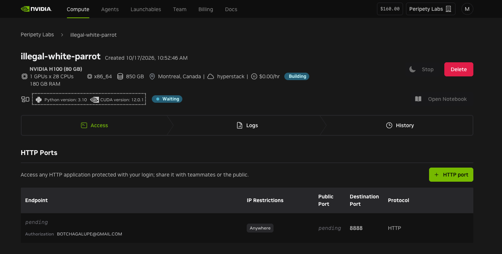

# Mini Gibson

**Keep the work moving.**

Experiment repository for the NVIDIA × Red Hat Small Models Hack, October 17–18, 2026.

**Judge-facing overview:** [read the plain-language submission summary](SUBMISSION.md).

## What we are submitting

Mini Gibson is a reproducible **training and evaluation pipeline for improving
coding agents**. It prepares historical engineering trajectories, runs bounded
LoRA fine-tunes, compares model variants inside the same locked evaluator, and
keeps tamper-evident receipts for every decision.

This repository is not a claim that we have already shipped a production-ready
autonomous coding model. The first fine-tune produced a promising development
signal, but it did not pass the statistical and reliability gates. The pipeline
did what it was designed to do: it kept the negative evidence and refused to
promote the adapter.

Submission materials are being finalized on October 18, 2026. Everything
verified by the repository cutoff will be committed today. If a terminal model
comparison has not been reached, that result will be reported as inconclusive;
we will not infer a missing finding. See the
[project map](docs/PROJECT-MAP.md) for the core repositories, exact model and
data sources, sealed holdout provenance, and proposed next integrations.

Our sanitized synthetic-fixture observational datasets are public in this
repository: the
[1,000-row v1.1 sanitized release](training/dataset/observational/releases/433-v1.1-sanitized/) and the
[105-row hard development release](training/dataset/observational/releases/433-v2-hard/),
along with their [dataset card](training/dataset/observational/DATASET-CARD.md),
schema, and reusable fixtures. Third-party datasets remain
linked at their pinned upstream revisions rather than being republished here.

## Demo and final findings

[Watch the latest 3:30 demo](presentation/demo/mini-gibson-demo.mp4) ·
[Transcript](presentation/demo/transcript.txt) ·
[Editable project ZIP](presentation/demo/mini-gibson-demo-project.zip)

The [narrated demo and editable project](presentation/demo/README.md) explain our
question: can a specialized small model reduce the checking, coordination, and
rescue that makes the human a development bottleneck?

The editable [final-findings deck](presentation/final-findings/README.md) and
[project map](docs/PROJECT-MAP.md) provide the judge-facing summary and verified
links to the directly related projects, models, datasets, and proposed tools.

The completed v1 comparison resolved **9 of 48** development issues with the
base model and **16 of 48** with the tuned model, an observed increase of 14.58
percentage points. The exact paired result did not reach the preset statistical
boundary (`p=0.0717316`), and tasks affected by malformed responses increased
from **8 of 48** to **21 of 48** (`p=0.000488`). The adapter was not promoted.

The successor experiment screens all 456 frozen SWE-rebench task packages for
safe evaluator compatibility before more training or model evaluation. Its
terminal, public-safe matrix and plain-language conclusion will be published in
[`docs/evidence/mini-gibson-successor-2026-10-18/`](docs/evidence/mini-gibson-successor-2026-10-18/).
That preflight runs no model, agent, parser, or tests, and the 35-task final
holdout remains operationally sealed and unconsumed by the pipeline.

See the demo's [sanitized evidence](presentation/demo/evidence/README.md) for
the earlier 7B rehearsal, 30B development batches, and tool-calling lessons.

## Question

> Can a small open model become measurably more reliable at autonomous software engineering when it operates inside an evidence-driven engineering environment—and improve further by learning from real historical engineering trajectories?

## Hackathon fit

Mini Gibson's primary fit is the **Tool-Calling** track: choosing tools,
formatting valid calls, recovering from errors, verifying work, and failing
safely. It also demonstrates specialization with NVIDIA Nemotron 3.5 Lightning
and fits the event's 33-billion-parameter ceiling. We are entering the pipeline
and its evidence, not presenting an unverified model as an open production
release. See the [official challenge description](https://luma.com/nvidia-redhat-small-models-hack).

## Experiment

```
MODEL + AGENT + ENVIRONMENT + TASK = RUN → EVIDENCE → SCORE
```

Reference model: NVIDIA Nemotron 3.5 Lightning. Reference agent candidate: Hermes. Agents are substitutable only after passing a frozen conformance contract. GibsonEnv owns declared tools, evidence, verification, and completion authority.

The pipeline supports this controlled comparison:

1. **Baseline** — base Nemotron under a frozen minimal comparable agent/tool protocol.
2. **Harness** — same model with Gibson's evidence-driven engineering environment.
3. **Historical learning** — specialized Mini Gibson model with the same environment.

The experiment protocol, task order, stop rules, and promotion boundaries are
frozen before outcomes are examined.

## Compute environments

The initial hackathon training environment used an NVIDIA H100 (80 GB) instance
on Brev.
The [October 17 environment evidence](docs/evidence/brev-h100-2026-10-17.md)
preserves the team-supplied console screenshot and the hardware shown there.
At capture, the instance was **Building** and the environment was **Waiting**;
completed training and model results require separate run receipts. The
successor compatibility run uses a separate two-A100 environment, whose exact
rate, controller window, and terminal hashes are recorded in its evidence
package.



## Principles

- The model cannot award itself `VERIFIED`.
- Failed engineering attempts are evidence.
- Infrastructure retries and task retries are different.
- Holdouts stay untouched by prompt, harness, reward, and training decisions.
- Negative results are valid.
- Reproducibility is a deliverable.

Holdouts, source training data, secrets, and model artifacts require their own
release decision. The public demo package contains selected evidence summaries,
not a corpus or model release.

## Optional Jev advice

The optional [Jev decision service](docs/jev.md) uses TypeSafe's official typed-decision API, is disabled by default, and never replaces Nemotron or GibsonEnv's completion authority. The implemented tool-risk hook records advice without changing permissions. Supervisor/routing and anomaly hooks are exported for future runner integration. Scored runs exclude remote Jev calls by default; an alternative mode validates a frozen policy identical across every declared arm.

Mark/Codex owns the adapter/configuration, fairness checks, telemetry and runtime tests; John/Grok owns future post-outcome anomaly/report consumption; Claude independently reviews and coordinates shared contracts. The Jev extension does not waive the pending design freeze.

Install with Python >=3.11 (`python -m pip install -e .`) and run `python -m unittest discover -v`. Tests use deterministic API fixtures; no live TypeSafe credential setup or API verification is included.

## Agent handoff (#433 observational baseline)

**Agents: start at [`docs/433-agent-kit/README.md`](docs/433-agent-kit/README.md).**

That kit has the workplan, copy-paste prompts (Codex + Claude computer use), Mark/John oversight checklist, portable runners, fixtures, schema, and a sample of real traces.

Related:

- Kickoff notes: [`docs/433-nemotron-baseline-kickoff.md`](docs/433-nemotron-baseline-kickoff.md)
- Canonical issue: https://github.com/The-AIE/the-gibson/issues/433
- Data layout: [`training/dataset/observational/`](training/dataset/observational/)

## License

See [LICENSE](LICENSE).
