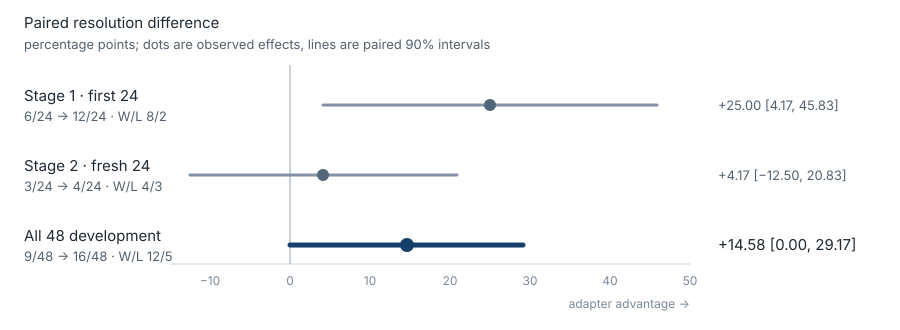

# The adapter resolved more issues, but worse tool reliability prevents calling it a clear upgrade

**Development-set evidence, not a final-holdout or production-performance claim.**

The Nemotron 3.5 Lightning OpenHands adapter resolved **16 of 48** fresh development issues, compared with **9 of 48** for the frozen base model. That is a directional gain of **7 tasks / 14.58 percentage points**. In paired terms, the adapter won 12 issues and lost 5. The predeclared positive rule was not met: the one-sided exact paired p-value was **0.0717**, above the required 0.05 boundary, and the 90% paired bootstrap interval reached zero.

The effect also weakened sharply in the fresh second cohort, while malformed model responses rose from **1.81% to 8.40% of generations** and affected **21/48 tuned tasks versus 8/48 base tasks**. The current evidence supports “promising resolution signal, unreliable tool behavior,” not “better model.”

## Paired outcomes

| Cohort | Both failed | Tuned-only win | Base-only win | Both passed | Base | Tuned |
|---|---:|---:|---:|---:|---:|---:|
| Stage 1, first 24 | 10 | **8** | 2 | 4 | 6/24 | 12/24 |
| Stage 2, fresh 24 | 17 | **4** | 3 | 0 | 3/24 | 4/24 |
| **All 48** | **27** | **12** | **5** | **4** | **9/48** | **16/48** |

Stage 1 showed a large +25.00-point gain but narrowly missed the predeclared exact-test boundary (p=0.0547). The fixed expansion added 24 new, disjoint issues. Stage 2 produced only a +4.17-point gain (p=0.5), so the first-stage effect did not replicate strongly. Per the protocol, the study stops at 48 rather than adding same-type tasks in response to the result. Final holdouts remain untouched.

## Reliability gate

| Measure, all 48 | Base | Tuned |
|---|---:|---:|
| Malformed responses / generations | 8/443 (1.81%) | 21/250 (8.40%) |
| Tasks with any malformed response | 8/48 | 21/48 |
| Tuned-only / base-only affected tasks | — | 14 / 1 |
| Harness errors | 0 | 0 |
| Policy violations | 0 | 0 |
| Test tampering | 0 | 0 |
| Unauthorized file changes | 0 | 0 |

The paired task-incidence test for the malformed-response regression is one-sided p=0.000488. This is not a cosmetic metric: a coding agent that resolves more of a small benchmark while emitting substantially more malformed tool calls is not yet a safe upgrade.

## Frozen experiment

- Base model: `nvidia/NVIDIA-Nemotron-3.5-Lightning-30B-A3B-BF16`
- Model revision: `a9904d24bcc1d289a1950fa9d2b978c47cf903b9`
- Training source: `nvidia/SWE-Hero-openhands-trajectories`, revision `150bc119e52c647216fce285fd801f16b6fd745b`
- Filtered examples: 188 train / 30 development, exact tool rendering, maximum 4,096 tokens
- Training: 94/94 optimizer steps; final training loss 0.487670; final validation loss 0.486048
- Source adapter: 202 tensors / 7,072,256 parameters, SHA-256 `7acf4381661099918c3d41c8196f919dbebd6e496831e1af5c59de6bf857a612`
- Inference adapter: 188 tensors / 6,749,696 parameters, SHA-256 `a7c6f56ea24527816a0a2c4aa652b7e28e4766ba902deaebb9186727d9bda23c`
- Offline exact adapter reload: passed
- Evaluation: networkless, deterministic decoding, identical prompts/tools, maximum 10 turns and 512 new tokens per turn

The remote training-data manifest attested in every tuned row was recovered and included as `training/training-data-manifest.json`; its SHA-256 is `adcc36778c0d64221133fb7d06e6b204bf972ec7f665049a0b22fbc7dbcbd704`.

## Post-study token-cap diagnostic

All 21 malformed tuned responses ended exactly at the original 512-token limit. A bounded rerun of only those affected development tasks at 1024 tokens reduced malformed tasks from 21 to 4 and recovered 8 passes, confirming a material evaluator/scaffold mismatch. It did not remove the reliability problem: 13 tasks still failed, 17 produced execution errors, and one attempted to modify a test file. A final 1536-token check recovered two of the four residual tasks; two still truncated. These adaptively selected reruns are diagnostic and do not change the frozen 48-task statistics or decision. See [the complete diagnostic report](diagnostics/token-cap/REPORT.md).

## Decision

Do not promote this adapter or spend the untouched final holdout. The next experiment should first address tool-format validity and increase diverse, successful, contamination-screened OpenHands supervision. Then run a newly preregistered paired study. The recommended data plan is in [DATASET-STRATEGY.md](DATASET-STRATEGY.md).
