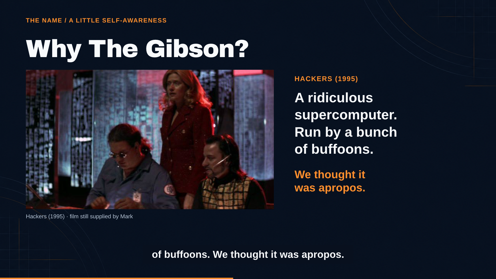

# Mini Gibson demo — keep the work moving

Can a specialized small model help AI development move forward without every
handoff, failed check, and repair waiting for a person?

[Watch or download the narrated MP4](mini-gibson-demo.mp4) ·
[Transcript](transcript.txt) · [Captions](captions.srt) ·
[Editable project ZIP](mini-gibson-demo-project.zip)

[](mini-gibson-demo.mp4)

This approximately 3:30 demo introduces Mark Hinkle and John Willis, the human
bottleneck, The Gibson, Agent Kontrol, the two model/data tracks, vLLM, and the
proposed NeMo Gym, Jev, and Langfuse connections. Narration uses Mark's authorized
ElevenLabs voice clone. The editable project uses the frozen audio; no voice API
credential is required to replay or render it.

The “Why The Gibson?” segment uses Mark's supplied still from *Hackers* (1995) and his self-deprecating naming joke, then returns to the engineering process. The [film/image source note](evidence/gibson-name-source.json) records the attribution and asset hash.

The final narration runs about 10.3% faster with its pitch preserved, bringing the video to 3:30. Captions and visual cues are retimed together, with a three-second closing hold. See the [audio pacing record](project/audio_meta.json).

## What the slow start taught us

Mark reports overloaded providers; the records also document stalled/failed builds and an unavailable container image. Once the team got runs working, the data exposed broken examples and cases where the token limit removed the answer. The next lesson was behavioral: a model can answer and return a valid tool call while still failing to finish a real repository task. The [startup source note](evidence/startup-lessons-source.json) separates Mark's account from the logged setup problems.

## Progress reviewed on October 17, 2026

| Track | What the records establish | What remains unproven |
| --- | --- | --- |
| OpenCodeReasoning-Nemotron-7B | 20-step LoRA rehearsal on Brev H100; 188 train / 30 dev rows from 283 source records, at a 2,048-token limit. The subsequent execution report records vLLM 0.11.0 health, model-listing, chat and required-tool checks passing. | The first real repository coding task failed and applied no edit. Endpoint checks do not establish autonomous engineering competence. |
| Nemotron 3.5 Lightning 30B | A loaded adapter was evaluated with Transformers/PEFT. Archived v7 records show **6/24 base** and **12/24 adapter** development tasks passing under matched task fixtures, harness, contracts and budgets. | These reused development fixtures are not final holdouts. The exact training-data record is unresolved; a complete local optimizer-step receipt was not recovered. |

**The counts are exploratory development observations. Final held-out quality,
promotion readiness, and reduced human intervention remain unproven.** The 7B
and 30B tracks use different data and execution paths. The 30B results are not a
vLLM result, and the 7B run does not prove 30B training completed.

The [evidence directory](evidence/README.md) contains sanitized result rows,
source hashes, the archived v7 provenance lock, a public summary of the original
7B rehearsal receipt, its metric files, and an endpoint execution-report summary.
It excludes corpus text, conversations, generated diffs, credentials and hostnames.
The 7B endpoint summary is documentary evidence; no live endpoint was reprobed
while producing this demo. A 30B configuration specifying 94 steps is not a
completed-step receipt.

The OpenHands preparation metadata identifies
[`nvidia/SWE-Hero-openhands-trajectories`](https://huggingface.co/datasets/nvidia/SWE-Hero-openhands-trajectories)
at revision `150bc119e52c647216fce285fd801f16b6fd745b`. Its prepared row counts are
not asserted to be the exact inputs for the evaluated adapter. No source corpus
or model weights are included here.

## Inspect and replay

Recount the committed receipts without running a model:

```bash
python3 presentation/demo/verify_evidence.py
```

Open the editable video:

```bash
cd presentation/demo/project
npm run dev
```

Render from the pinned HyperFrames 0.8.169 project:

```bash
npm run render -- --quality delivery --output ../mini-gibson-demo.mp4
```

Node.js 22 or newer and FFmpeg are required. The first `npx` invocation may fetch
the pinned CLI. The project includes its audio, screenshots, logos, backgrounds,
and the Arimo and Archivo Black fonts with their upstream license notices and
[source hashes](project/assets/fonts/SOURCES.json).

[Media verification](verification.json) records dimensions, runtime, audio,
full-file decoding, and comparisons with inspected preview frames. The
[file manifest](FILES.sha256.json) records the published artifact hashes.
